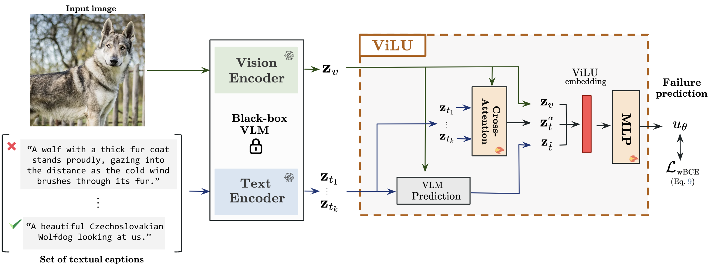

# ViLU: Learning Vision-Language Uncertainties for Failure Prediction

Official PyTorch implementation of [ViLU](https://arxiv.org/abs/2507.07620) (ICCV 2025).



ViLU is a post-hoc uncertainty model for frozen vision-language models such as CLIP. Given an image
and the candidate classes or captions, it predicts whether the VLM's zero-shot prediction is
correct, from the visual embedding, the embedding of the predicted caption and an image-conditioned
textual representation obtained by cross-attention. It is trained as a binary classifier of
correctness, so it needs no access to the VLM's pre-training loss.

## Installation

```bash
conda create -n vilu python=3.11
conda activate vilu
pip install torch torchvision          # pick the build matching your CUDA version (pytorch.org)
pip install -r requirements.txt
pip install -e .
```

The notebooks additionally need `pip install -r requirements-notebooks.txt`. CLIP weights are
downloaded on first use to `~/.cache/clip`.

## Datasets

Paths are relative to the repository root by default (`dataset.path=...` overrides them):

```
data/
├── ImageNet/                  # torchvision layout
│   ├── ILSVRC2012_devkit_t12.tar.gz
│   ├── train/
│   └── val/
├── CIFAR-10/cifar-10-batches-py/
├── CIFAR-100/cifar-100-python/
├── caltech101/101_ObjectCategories/
├── EuroSAT_RGB/
├── dtddataset/dtd/images/
├── fgvc-aircraft-2013b/
├── flowers102/
├── food-101/images/
├── oxford-iiit-pet/images/
├── stanford_cars/
├── SUN397/
├── UCF-101-midframes/
└── CC12M/                     # WebDataset shards
    ├── train/
    └── val/
```

## Pretrained checkpoints

The `weights/` folder holds a ViLU model and an LVU baseline (same MLP, visual input only, trained
with an MSE loss) for each dataset, all for CLIP ViT-B/32:

| Dataset | ViLU | LVU |
|---|---|---|
| CIFAR-10 | `weights/vilu_cifar10.ckpt` | `weights/lvu_cifar10.ckpt` |
| CIFAR-100 | `weights/vilu_cifar100.ckpt` | `weights/lvu_cifar100.ckpt` |
| Caltech101 | `weights/vilu_caltech.ckpt` | `weights/lvu_caltech.ckpt` |
| Flowers102 | `weights/vilu_flowers.ckpt` | `weights/lvu_flowers.ckpt` |
| OxfordPets | `weights/vilu_pets.ckpt` | `weights/lvu_pets.ckpt` |
| Food101 | `weights/vilu_food.ckpt` | `weights/lvu_food.ckpt` |
| FGVCAircraft | `weights/vilu_aircraft.ckpt` | `weights/lvu_aircraft.ckpt` |
| EuroSAT | `weights/vilu_eurosat.ckpt` | `weights/lvu_eurosat.ckpt` |
| DTD | `weights/vilu_dtd.ckpt` | `weights/lvu_dtd.ckpt` |
| SUN397 | `weights/vilu_sun.ckpt` | `weights/lvu_sun.ckpt` |
| StanfordCars | `weights/vilu_cars.ckpt` | `weights/lvu_cars.ckpt` |
| UCF101 | `weights/vilu_ucf.ckpt` | `weights/lvu_ucf.ckpt` |
| ImageNet-1k | `weights/vilu_imagenet.ckpt` | `weights/lvu_imagenet.ckpt` |

The ImageNet-1k checkpoints were retrained in 2026, as the original files had not been released.
ViLU uses `scripts/train_vilu_imagenet.sh` (SGD, lr 1e-3, 300 epochs) and LVU
`scripts/train_lvu_imagenet.sh` (lr 1e-2). On ImageNet-1k val they reach:

| | AUC ↑ | FPR95 ↓ |
|---|---|---|
| ViLU, paper (Table 1) | 89.5 | 47.4 |
| ViLU, `weights/vilu_imagenet.ckpt` | 90.8 | 43.1 |
| LVU, paper (Table 1) | 78.7 | 77.0 |
| LVU, `weights/lvu_imagenet.ckpt` | 75.5 | 79.3 |

`scripts/eval_imagenet.py` recomputes these numbers:

```bash
python scripts/eval_imagenet.py --ckpt weights/vilu_imagenet.ckpt --model vilu --data-root data/ImageNet
```

A checkpoint loads into `ViLUAttention`:

```python
import torch
from vilu.models import ViLUAttention

vilu = ViLUAttention(concat=True, identity_init=True, use_predicted_caption=True, use_attention=True)
lvu = ViLUAttention(concat=True, identity_init=True, use_predicted_caption=False, use_attention=False)
vilu.load_state_dict(torch.load("weights/vilu_cifar10.ckpt", map_location="cpu", weights_only=False)["state_dict"])
lvu.load_state_dict(torch.load("weights/lvu_cifar10.ckpt", map_location="cpu", weights_only=False)["state_dict"])
```

The model takes L2-normalised CLIP image embeddings and the L2-normalised text embeddings of the
class prompts (`"a photo of a {}."`) and returns a confidence logit per image. The notebooks show the
full evaluation for each dataset.

## Training

Training scripts are in `scripts/`; each runs on a single GPU:

| Script | Model | Dataset |
|---|---|---|
| `scripts/train_vilu_cifar10.sh` | ViLU, CLIP ViT-B/32 | CIFAR-10 |
| `scripts/train_vilu_vitl4_cifar10.sh` | ViLU, CLIP ViT-L/14 | CIFAR-10 |
| `scripts/train_lvu_cifar10.sh` | LVU | CIFAR-10 |
| `scripts/train_vilu_imagenet.sh` | ViLU, CLIP ViT-B/32 | ImageNet-1k |
| `scripts/train_lvu_imagenet.sh` | LVU | ImageNet-1k |

```bash
sh scripts/train_vilu_cifar10.sh
```

Training ViLU on CIFAR-10 takes about 2 hours on an RTX A6000. Configuration uses
[Hydra](https://hydra.cc): defaults live in `vilu/config/`, and any value can be overridden on the
command line. `vilu/run.py` scales the learning rate by the number of GPUs; the training loop is in
`vilu/engine/trainer.py`.

## Notebooks

`notebooks/` contains, for each dataset, the evaluation of the pretrained ViLU and LVU models against
MCM, and the visualisation of the uncertainty distributions of correct and incorrect predictions.


## Citation

```bibtex
@inproceedings{lafon2025vilu,
  title     = {ViLU: Learning Vision-Language Uncertainties for Failure Prediction},
  author    = {Lafon, Marc and Karmim, Yannis and Silva-Rodr{\'\i}guez, Julio and Couairon, Paul and
               Rambour, Cl{\'e}ment and Fournier-Sniehotta, Rapha{\"e}l and Ben Ayed, Ismail and
               Dolz, Jose and Thome, Nicolas},
  booktitle = {Proceedings of the IEEE/CVF International Conference on Computer Vision (ICCV)},
  year      = {2025}
}
```

## License

MIT, see `LICENSE`.
